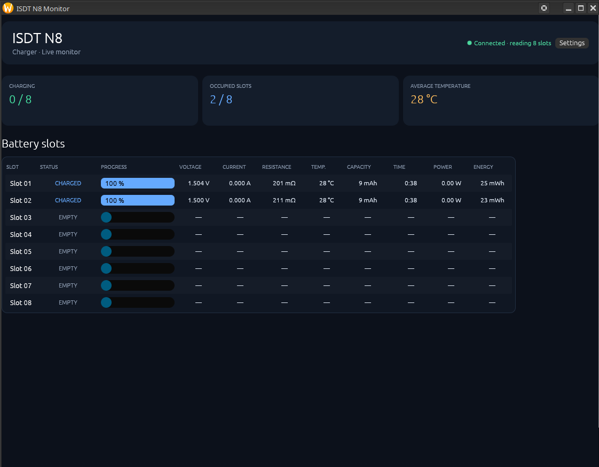

# ISDT N8 Monitor

A small cross-platform Rust desktop app for viewing live measurements from an ISDT N8 battery charger.

Current release: **0.1**. Prebuilt downloads are attached to the [GitHub release](https://github.com/trashcoder/isdt-n8-monitor/releases/tag/v0.1).



## Features

- Live table for all eight battery slots, including status and charge-progress bars
- Per-slot voltage, current, resistance, temperature, capacity, time, power, and energy
- Empty slots display dashes instead of residual sensor readings
- English and German interface, with the language preference saved between launches
- Linux USB permission setup through a one-time, device-specific udev rule
- Read-only charger communication: no firmware, settings, rename, or reboot commands

## Device and protocol status

The app currently targets the ISDT N8 identified as USB vendor/product ID `28e9:028a`. Its USB protocol was reverse-engineered from observed device responses and publicly available protocol work. This is an independent community project and is not affiliated with ISDT.

The channel metrics request has been exercised with an N8. The displayed channel fields were compared with the charger's own screen. The USB input reading shown by the charger (for example, 5.2 V / 10.0 W) has not yet been confirmed in the N8 USB responses and is labelled accordingly in the app. Other ISDT charger models have not been verified.

This project is experimental. Device firmware and charger behavior may vary by model or firmware version. The app only issues the read-only channel metrics request that has been tested so far.

## Build and run

Install [Rust](https://www.rust-lang.org/tools/install) (Rust 1.95 or newer), connect the charger, and run:

```sh
cargo run --release
```

To build a release executable:

```sh
cargo build --release
```

Build on the target operating system to create a native binary for Linux, Windows, or macOS. Linux and Windows compilation have been checked; macOS has not yet been verified.

## Linux USB permissions

If the app detects the charger but cannot open its HID interface, it offers a one-time permission setup. Approving it opens the system `pkexec` prompt and installs:

```text
/etc/udev/rules.d/70-isdt-n8-monitor.rules
```

The rule grants the active desktop user access only to USB ID `28e9:028a`. The GUI continues to run as the regular user. `pkexec` and `udevadm` are required. Windows and macOS normally allow user applications to access HID devices without administrator rights.

## Development

Format and check the project with:

```sh
cargo fmt --all
cargo check
```

## Known limitations

- USB input voltage and power are not decoded yet.
- Runtime access and display behavior have been exercised on Linux; Windows has had a cross-compilation check, and macOS still needs a build and device test.
- The app currently supports the N8 protocol path only; compatibility with other ISDT chargers is unknown.
